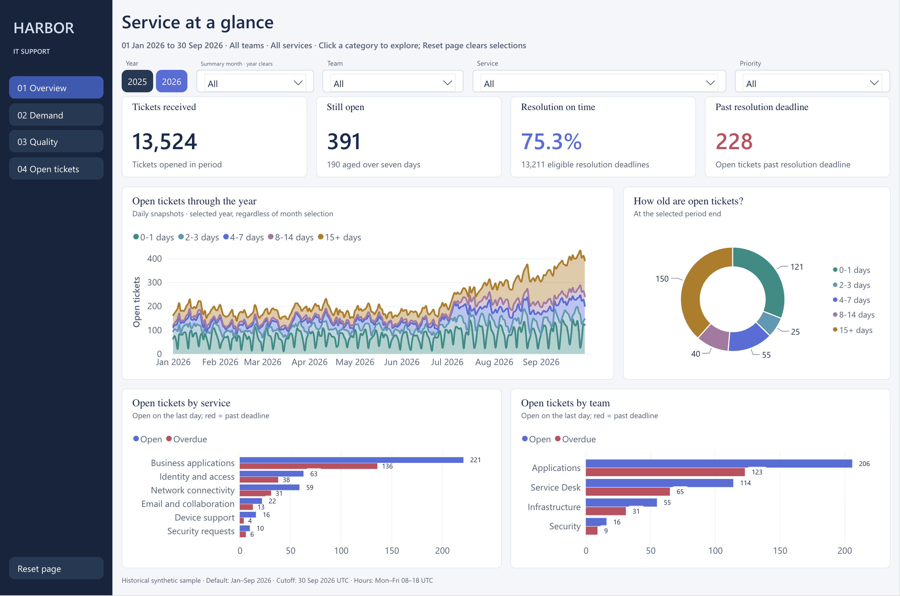
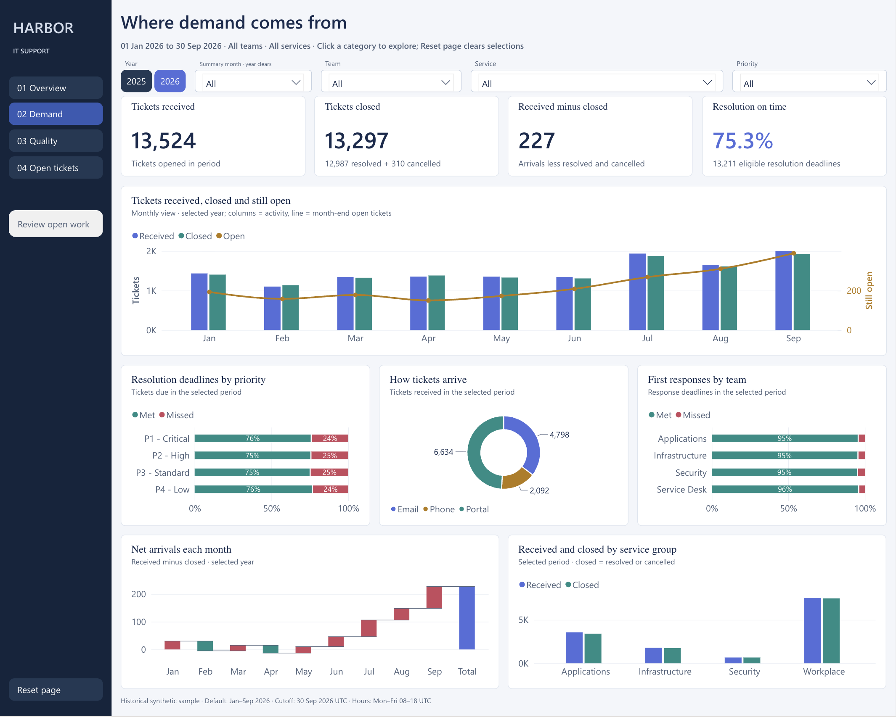
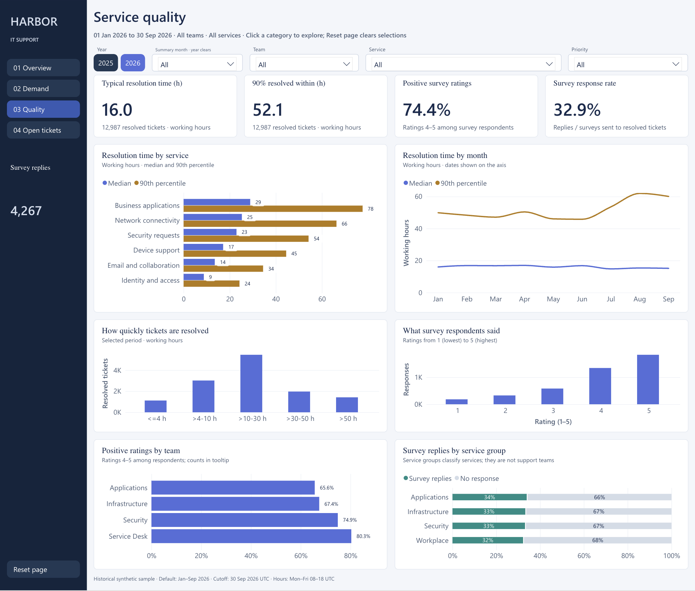
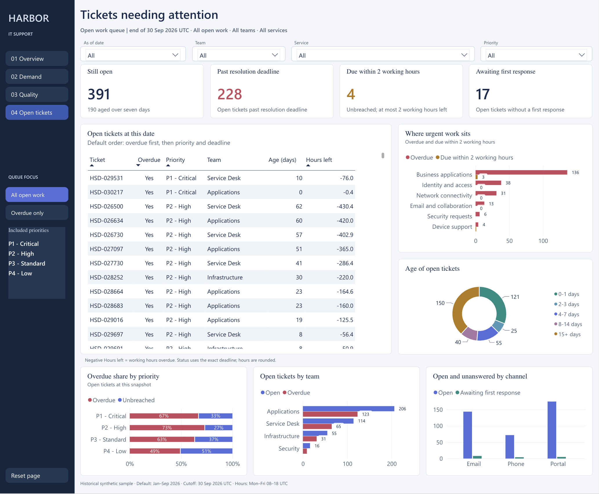

# Harbor Service SLA & Operations

A four-page Power BI case study examining where IT support demand comes from, whether service deadlines are being met, and which open tickets need attention.

Harbor is fictional. All ticket records are synthetic; the results demonstrate analytical techniques and do not represent real client outcomes.

[Explore the interactive report](https://app.powerbi.com/view?r=eyJrIjoiNGRjNWYyNGMtYzBhMC00ZDczLWI3YjgtMTJlYzg5MjI2MzY4IiwidCI6IjhiYmMwZjRiLTVkNWItNGNiMy05ZWM5LTc1MTc0MjRmMzY0ZiJ9)

## Report pages

| Page | Focus |
|---|---|
| Overview | Ticket demand, backlog, SLA performance, and ageing |
| Demand | Received and closed tickets, priorities, channels, and support teams |
| Quality | Median and 90th-percentile resolution times, survey sentiment, and response rates |
| Open tickets | Overdue work, approaching deadlines, first responses, and a prioritized ticket queue |

The report includes service and priority drillthrough, shared filters, and reset controls. The fixed snapshot ends on 30 September 2026. Resolution duration uses working hours; survey results describe respondents rather than all ticket holders.

## What the default view shows

The January–September 2026 view shows 13,524 received tickets, 391 open at the cutoff, 75.3% resolution on time, and 228 open tickets past their resolution deadline. These are synthetic case-study results, not achieved business improvements.

## Tools and data

Power BI, Power Query, DAX, and synthetic CSV data. AI assistance was used for synthetic-data generation.

## Validation

The native model passed 232 regression cases against reviewed reference outputs covering 35,059 compared values, plus five supplemental cases covering 62 values. Native and signed-in Service checks covered filters, navigation, drillthrough, resets, sorting and reopen defaults. Anonymous browser checks confirmed all four normal pages, queue sorting and resets, and both January P2 drillthrough routes. See [validation notes and accepted limitations](docs/VALIDATION.md).

## Report screenshots

Default view: January–September 2026, all teams, services and priorities. The open-ticket page shows the 30 September cutoff.

### 01 · Overview

Ticket demand, SLA performance and the concentration of open work.

### 02 · Demand

Arrivals, closures and net flow, with priority and team context.

### 03 · Quality

Typical resolution time and the long tail, alongside survey sentiment and participation.

### 04 · Open tickets

A historical work queue ordered by overdue status, priority and remaining working time. Negative hours indicate time past the resolution deadline.

## Reading the measures

- **Demand** uses ticket creation dates; closures include resolved and cancelled tickets.
- **SLA performance** uses deadlines eligible in the selected period. It is a different population from tickets resolved in that period.
- **Resolution time** uses the resolved-date cohort and working hours. The median and 90th percentile show typical duration and the long tail.
- **Open work** uses a historical end-date snapshot rather than current ticket status.
- **Survey sentiment** describes respondents. The response rate and reply count provide essential context.

The model separates ticket lifecycle events from daily open-ticket snapshots and shares date, team, service, priority and channel dimensions. Power Query handles CSV ingestion and DAX applies the distinct date and population rules.

## Scope and limitations

This is a fixed synthetic portfolio snapshot, not a production service desk or a live refresh feed. No real client outcomes or measured business improvements are claimed. The external CSV source paths would need configuration in another refresh environment. Some native keyboard and screen-reader limitations remain documented in the [validation notes](docs/VALIDATION.md).
